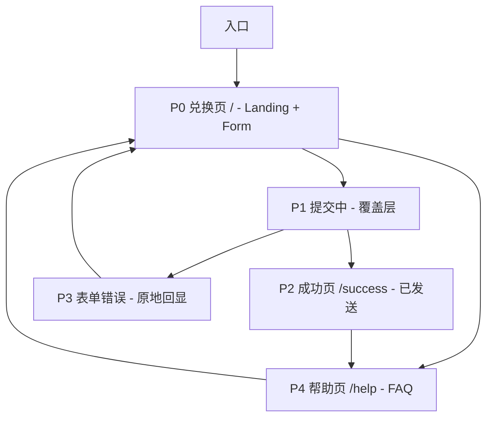
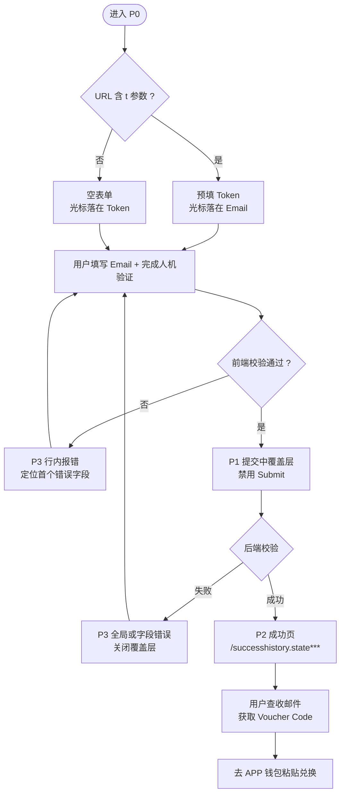
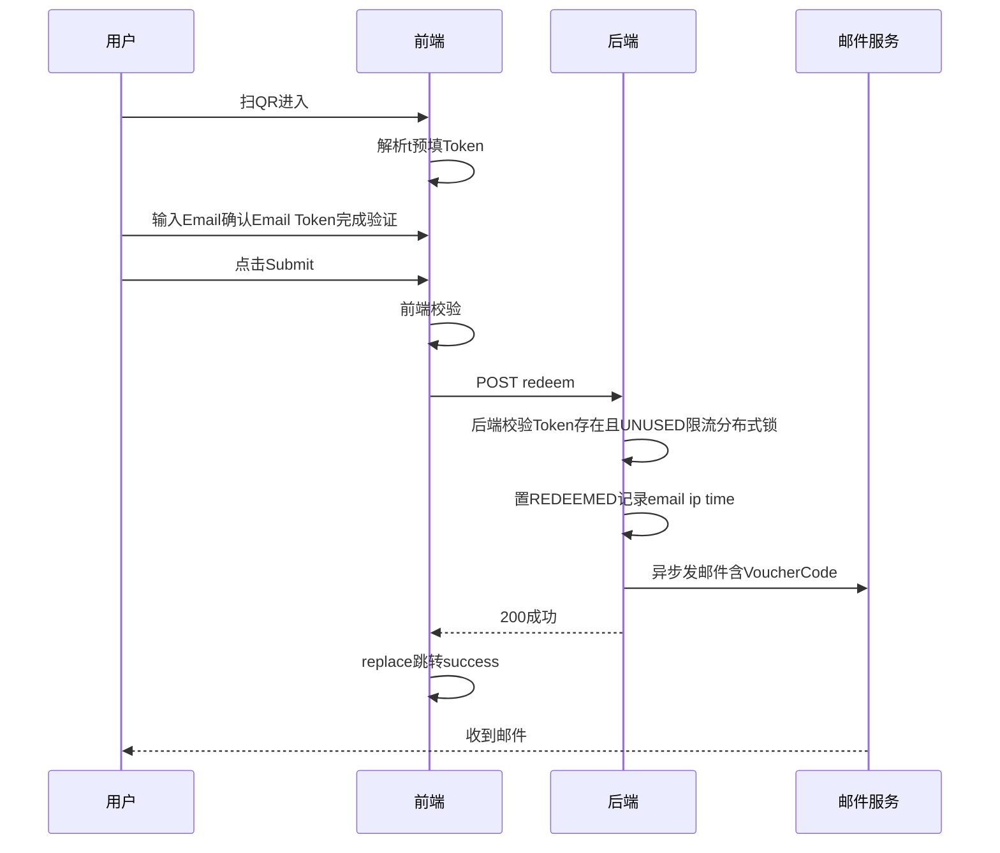

# V2Power 优惠券兑换站 - 交互逻辑（IA）

> 版本 v1.2  2026-08-25  关联 PRD（已合入老板9项反馈）：`docs/specs/2026-08-24-v2power-voucher-redeem-website-prd.md`
> 范围：仅 C 端兑换链路页面跳转与状态流转，暂不涉及 UI 视觉稿与后端实现细节。

## 1. 设计目标与原则

- **单任务单页为核心**：90% 用户一次完成兑换，不做多步向导。
- **Token 预填可改**：扫码 `?t=` 自动预填，手动输入为兜底，两者同权。
- **不回显 Voucher**：兑换成功仅提示已发邮件，真券只在邮件中，避免截屏冒领。
- **错误就地解决**：字段级与全局错误区分展示，不跳中间页。
- **无账号体系**：全程无需登录，唯一凭证为邮箱。

## 2. 站点地图

> 实际路由建议：`/` 承载 P0+P1+P3，`/success` 承载 P2，`/help` 承载 P4。`P1` 为 `/` 上的模态覆盖层而非独立路由，避免刷新丢失表单状态。

## 3. 页面清单

| 编号 | 名称 | 路由 | 进入方式 | 核心内容 | 退出条件 |
|------|------|------|----------|----------|----------|
| P0 | 兑换页 | / 或 /?t=TOKEN | 扫 QR、手动输入域名、P3 返回、P4 返回 | V2Power 宣传区 + 表单：Email / Token / 人机验证 + Submit + Help 入口 | 校验通过提交 |
| P1 | 提交中 | / 覆盖层 | P0 点击 Submit 且前端校验通过 | 全屏半透明遮罩 + 旋转指示 + 文案正在验证 + 禁用二次提交 | 接口返回 |
| P2 | 成功页 | /successhistory.state*** | P1 接口成功 | 成功图标 + 已发送至 xxx@yyy.com + 查收指引 + 垃圾箱提醒 | 关闭标签或返回首页+WhatsApp |
| P3 | 表单错误 | / 原地 | P1 接口失败或前端校验失败 | 行内错误提示 + 全局错误条 | 修正后重提 |
| P4 | 帮助页 | /help | P0/P2 页脚或错误码旁需要帮助 | FAQ：收不到邮件 / Token 无效 / 邮箱输错 / 联系客服 | 返回 P0 |

## 4. 核心流程图 - Happy Path

## 5. 时序图 - 前后端交互

## 6. 页面细节与字段规则

### 6.1 P0 兑换页

- **URL 参数**：`?t=TOKEN` 预填 Token 输入框，预填后允许编辑；非法或超长 Token 截断提示，不阻断页面加载。
- **表单字段**：
  - Email 必填，实时格式校验，失焦提示。
  - 
  - Token 必填，支持粘贴自动去空格，大小写不敏感归一。
  - 人机验证：Cloudflare Turnstile（无感）+GDPR勾选，开发环境为 none。
- **Submit 按钮**：默认禁用，全部必填且验证通过才可点击；点击后立即进 P1。
- **辅助**：页头 V2Power 品牌区，页脚 Help 与隐私说明入口。
- **草稿**：输入中写入 sessionStorage，刷新可恢复，成功后清除。

### 6.2 P1 提交中

- 全屏遮罩，阻止表单二次编辑与重复提交；显示进度文案 已提交，正在处理…
- 超时 15s 不直接报错TOKEN_REDEEMED：自动转为全局提示 网络超时，但兑换可能已成功 — 请先检查邮箱（含垃圾箱），10 分钟内未收到再重试；提供 返回重试 与 去帮助页/WhatsApp 客服 入口，并退回 P3 保留表单数据。
- 浏览器刷新/关闭：若请求已发出，提示 正在处理，请稍后查询邮箱，避免重复提交导致 已兑换 报错。

### 6.3 P2 成功页

- 仅展示脱敏邮箱，如 `a***@gmail.com`，完整邮箱通过 `history.state` 参数传递后脱敏显示。
- 不展示 Voucher Code，不展示 Token。
- 文案：已发送（含面额 {{amount}} 与有效期 {{expiresAt}} 占位说明）、去 APP 钱包粘贴、垃圾箱检查、未收到可返回重试或 WhatsApp 客服。
- 提供返回首页+WhatsApp链接，不提供再次提交。

### 6.4 P3 表单错误

- **行内错误**：Email 格式、两次不一致、Token 为空、验证未完成，定位首错并聚焦。
- **全局错误条**：Token 不存在、已兑换、已过期、限流、服务异常。
- 错误码透出小字，便于客服排查。
- 成功后错误状态清空。

### 6.5 P4 帮助页

- FAQ 至少 5 条：收不到邮件（垃圾箱/延迟）、Token 无效、邮箱填错怎么办、有效期、多设备领取；成功页同样提供 WhatsApp 直达。
- 提供客服邮箱 support@v2power.com 与 WhatsApp 直达链接 wa.me/...（P2/P4 均可点击），不提供在线表单避免滥用；邮件延迟场景优先引导 WhatsApp 兜底。

## 7. 状态与跳转矩阵

| 当前 | 事件 | 校验结果 | 下一状态 | 跳转方式 |
|------|------|----------|----------|----------|
| P0 | 点击 Submit | 前端不通过 | P3 行内 | 原地，不发请求 |
| P0 | 点击 Submit | 前端通过 | P1 | 原地覆盖层 |
| P1 | 接口 200 | 成功 | P2 | replace 跳转 /success |
| P1 | 接口 4xx/5xx | 失败 | P3 | 关闭覆盖层，原地展示 |
| P1 | 超时 | - | P3 | 超时条 |
| P2 | 点击返回首页+WhatsApp | - | P0 | push / |
| 任意 | 点击 Help | - | P4 | push /help，新标签可选 |
| P4 | 点击返回 | - | 来源页 | back 或 push / |

## 8. 错误码与提示文案

| 错误码 | 触发条件 | 前端提示 | 字段定位 |
|--------|----------|----------|----------|
| E001 | Email 格式非法 | 请输入有效的邮箱地址 | Email 行内 |
| E002 | Email 格式非法 | 两次输入的邮箱不一致 | 确认 Email 行内 |
| E003 | Token 为空 | 请输入 Token | Token 行内 |
| E004 | 人机验证未完成 | 请完成验证 | 验证组件旁 |
| E005 | 未勾选隐私政策 | 请勾选同意隐私政策 | 勾选框行内 |
| E101 | Token 不存在 | Token 无效，请检查印刷码 | 全局 |
| E102 | Token 已兑换 | 该 Token 已被使用 | 全局 |
| E103 | Token 已过期 | 该 Token 已过期，请联系发放方 | 全局 |
| E104 | Token 已作废 | 该 Token 已作废 | 全局 |
| E201 | 邮箱限流 | 该邮箱操作过于频繁，请稍后再试 | 全局 |
| E202 | IP 限流 | 请求过于频繁，请稍后再试 | 全局 |
| E500 | 服务异常 | 服务暂时不可用，请稍后重试 | 全局 |
| E504 | 网络超时 | 网络超时，请检查网络后重试 | 全局 |

## 9. 导航与存储规则

- **跳转语义**：P0 到 P2 使用 `replace`，避免回退重提；其余使用 `push`。
- **回退**：P2 回退不回到 P1，直接到 P0 空表单。
- **参数透传**：`?t=` 仅在 P0 消费，不透传到 P2；`history.state` 仅 P2 使用。
- **存储**：sessionStorage 存草稿 `voucher_draft`，输入防抖 500ms 写入，刷新可恢复；兑换成功后立即 `removeItem`，并在 `beforeunload` / 页面关闭时强制销毁，公共设备防泄露；不使用 localStorage。
- **Token 归一**：去空格、转大写、截断 64 字符，前端归一后提交。

## 10. 埋点事件

| 事件 | 时机 | 字段 |
|------|------|------|
| page_view | P0/P2/P4 加载 | page, referrer, has_t_param |
| form_start | 首个字段获得焦点 | - |
| submit_click | 点击 Submit | has_token_prefill |
| captcha_pass | 验证通过 | provider |
| redeem_success | 接口 200 | - |
| redeem_fail | 接口非 200 | error_code |
| help_open | 点击 Help | from_page |

## 11. 与 PRD 的关系

- 本文档为 PRD 的交互细化，不新增业务规则；与 PRD 不一致时以 PRD 为准。
- 开发同学提出的 7 步后端流程作为实现参考，不约束本交互的页面结构。
- 后续 UI 设计基于 P0-P4 页面清单展开。
