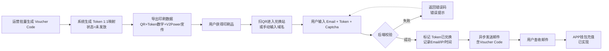

# V2Power 优惠券兑换网站（Voucher Redeem Website）产品需求文档 PRD

| 属性 | 内容 |
|------|------|
| **文档编号** | PRD-V2P-VOUCHER-20260824 |
| **版本** | v1.2 – 已合入老板9项反馈（表单回归单Email，IA/PRD统一） |
| **作者** | 需求方描述整理 + PM 补全规范 |
| **创建日期** | 2026-08-24 |
| **状态** | Draft / Pending Review |
| **关联系统** | V2Power 充电 APP（钱包充值模块已实现）、邮件服务、运维后台 |

> 变更记录
> | 版本 | 日期 | 修改人 | 变更说明 |
> |------|------|--------|----------|
> | v1.0 | 2026-08-24 | PM | 首版
| v1.1 | 2026-08-25 | PM | 按老板反馈合并双邮箱/GDPR/Turnstile/WhatsApp等9项
> | v1.2 | 2026-08-25 | PM | 完整合入双邮箱+GDPR阻塞+Turnstile降级+amount占位+邮件面额有效期+WhatsApp+history.state+超时幂等文案+草稿销毁：根据口头需求补全为可开发 PRD |

---

## 1. 项目概述

### 1.1 背景
V2Power 为充电 APP 会员/合作渠道批量发放 **优惠券码（Voucher Code）**，用于在 APP 内兑换钱包余额充值。但出于**防泄露、防爬取、可追溯**的考虑，优惠券码**不直接印刷发放**，而是通过 **Token 中间凭证** 间接兑换：

- 运营批量生成 `Voucher Code ↔ Token` 的 1:1 映射
- Token 以**二维码 + 人可读数字串 + V2Power 品牌宣传**的印刷品形式发放给用户
- 用户扫码进入**优惠券兑换网站**，输入 `Email + Token + 人机验证` ，提交后**由系统向该邮箱发送真正的 Voucher Code**

### 1.2 目标
1. 搭建一个轻量、安全、可追溯的 **Web 兑换站**，承接 Token → Voucher 的兑换链路。
2. 确保 Token **一次性、不可猜测、可作废**，全链路防机器人刷取。
3. 邮件**可达率高、合规（GDPR）**，用户体验在 60 秒内完成。
4. 为运营提供**批量生成、统计、对账、客诉排查**能力。

### 1.3 范围

| 在范围内 | 不在范围内（本次不做） |
|----------|------------------------|
| Token/Voucher 生成与映射管理（后台） | 充电 APP 内钱包充值逻辑（已实现） |
| 兑换网站 H5/PC 前端 | APP 内充值入口改动 |
| 后端校验、防刷、邮件发送 | 支付/退款 |
| 邮件模板与发送记录 | 纸质印刷品的设计与印刷执行（仅提供二维码/数字串规范） |
| 数据统计与日志 | 多语言除 EN 外的翻译（如需后续迭代） |

### 1.4 成功指标

| 指标 | 目标 |
|------|------|
| 兑换成功率（合法 Token 提交→邮件送达） | ≥ 98% |
| 邮件到达时间 P95 | ≤ 60 秒 |
| 人机验证误拦率 | ≤ 0.5% |
| Token 被暴力猜测成功率 | ≈ 0（熵 ≥ 80 bits + 限流） |

---

## 2. 术语与定义

| 术语 | 定义 | 示例 |
|------|------|------|
| **Voucher Code** | 可在充电 APP 钱包充值页直接兑换的优惠券码，已有系统可识别 | `VP-8K2F-9QWL-2026` |
| **Token** | 印刷品上的中间凭证，与 Voucher 1:1 绑定，兑换后即失效 | `V2P-TK-7F3K-9X2Q-PL84` |
| **QR Code** | Token 的二维码载体，扫码直达兑换站并可自动填充 Token | `https://voucher.v2power.com/?t=...` |
| **Redeem** | 兑换动作：用户在网站提交 Email+Token+验证 → 系统发邮件 | - |
| **兑换站** | 本 PRD 要建设的网站 | `voucher.v2power.com`（域名待定） |

> **关键约束**：Voucher Code 永不在兑换站前端明文展示，仅通过邮件发送；Token 与 Voucher 的映射关系不对用户可见。

---

## 3. 角色与用户故事

### 3.1 角色

| 角色 | 描述 | 权限 |
|------|------|------|
| **访客/会员用户** | 持有印刷 Token 的最终用户 | 兑换、收邮件 |
| **运营人员** | 批量创建/导出 Token、查看兑换统计、客诉处理 | 后台：生成、查询、作废、重发 |
| **管理员** | 系统配置、限流/邮件服务配置 | 后台全部 + 系统设置 |
| **系统** | 自动校验、发邮件、写日志 | - |

### 3.2 用户故事

- **US-01** 作为用户，我扫二维码进入网站，看到 V2Power 品牌信息，输入邮箱和 Token 数字并通过验证后提交，能在邮箱收到优惠券码，以便去 APP 充值。
- **US-02** 作为用户，若我输入错误的 Token 或已兑换过的 Token，能得到清晰的错误提示及客服指引。
- **US-03** 作为运营，我能批量导入/生成一批 Voucher Code 对应的 Token，并导出含二维码的印刷数据。
- **US-04** 作为运营，我能在后台按 Token/Email/时间查询兑换记录，并对未兑换 Token 作废或对已兑换记录重发邮件（限频）。
- **US-05** 作为管理员，我希望系统能防机器人批量刷取、限流并记录审计日志。

---

## 4. 业务流程

### 4.1 端到端流程图



### 4.2 状态机（Token）

```
未生成 → 未发放 → 已发放/可兑换 → 已兑换
                          ↘ 已过期 / 已作废
```
- `未发放`：已生成但未导出印刷
- `可兑换`：已导出，等待用户兑换；可设置 `过期时间`（如 12 个月）
- `已兑换`：终态，不可二次兑换；记录 `redeemed_at`, `redeemed_email`, `redeemed_ip`
- `已作废`：运营手动作废；作废后不可兑换
- `已过期`：超过 `expires_at` 自动过期

### 4.3 核心约束
1. Token **一码一兑**，兑换成功后立即失效；并发请求需行锁/乐观锁保证幂等。
2. Voucher Code **仅通过邮件**触达用户，网站任何页面、接口均不返回 Voucher 明文。
3. 同一 Token 已兑换后再次提交应提示“已兑换”并指引查邮件/联系客服，不可重发 Voucher 到新邮箱（防盗用），如需重发需走客服后台“重发原邮箱”流程。

---

## 5. 功能需求

### 5.1 F-01 兑换站前端 - 落地页/兑换页

| 编号 | 需求 | 优先级 | 验收要点 |
|------|------|--------|----------|
| F-01-01 | 响应式页面，支持移动端优先 + PC 自适应；V2Power 品牌头图/宣传语/底部版权 | P0 | 375px/768px/1280px 均无错位；首屏 LCP <2.5s |
| F-01-02 | 表单四要素：**Email 输入框、Token 输入框、人机验证组件** + GDPR 隐私勾选 + Submit 按钮 | P0 | 见 5.1.1 校验规则；未勾选隐私不可提交 |
| F-01-03 | 支持 QR 扫码带参自动填充：`?t={token}` 或 `?token={token}` 均可识别并填充到 Token 框（可编辑） | P0 | 扫码后 Token 自动填入 |
| F-01-04 | 提交状态：loading → 成功页 / 失败提示（不跳转新域） | P0 | 成功页提示“已发送至 xxx@yyy.com，请查收（含垃圾箱）” |
| F-01-05 | 隐私勾选：提交前需勾选 “我同意隐私政策” 并可点击查看隐私政策页 | P0 | 未勾选不可提交 |
| F-01-06 | 多语言：首版英文，结构支持 i18n | P1 | 文案抽离 |
| F-01-07 | 无障碍与 SEO：语义化标签、`og:title`、favicon | P2 | Lighthouse ≥90 |

**5.1.1 表单校验规则**

- Email：RFC 5321 简化校验 + 去空格转小写；长度 ≤254；实时提示格式错误。
- Token：支持带分隔符输入，提交前 `normalize`去分隔符转大写；字符集 `A-Z0-9`。
- GDPR 隐私勾选：必填且必须为 true，未勾选时 Submit 禁用。
- Captcha：见 F-03，采用 Cloudflare Turnstile 无感验证；失败降级为交互式挑战，开发可用 `none` 跳过。
- Submit 按钮：四项均通过才可点击；防抖 1.5s。

### 5.2 F-02 后端 - 兑换校验与发放

| 编号 | 需求 | 优先级 |
|------|------|--------|
| F-02-01 | POST /api/redeem 接收 email, token, captchaToken, consent，服务端二次校验邮箱格式、token 归一化、consent=true | P0 |
| F-02-02 | 校验 captchaToken（服务端向验证提供商验签），失败返回 CAPTCHA_FAILED | P0 |
| F-02-03 | 校验 Token：不存在 → TOKEN_INVALID；已兑换 → TOKEN_REDEEMED；已作废/过期 → TOKEN_INACTIVE | P0 |
| F-02-04 | 校验通过则原子化标记已兑换（DB 行锁 SELECT ... FOR UPDATE 或乐观锁），写入 redeemed_email, redeemed_at, redeemed_ip, user_agent | P0 |
| F-02-05 | 异步触发邮件发送（队列/重试），邮件发送失败不回滚兑换状态，但需记录 email_status=failed 并支持后台重发 | P0 |
| F-02-06 | 幂等：同一 Token 并发请求，仅首个成功，其余返回 TOKEN_REDEEMED；同一请求重复提交（去重键 token+email 5分钟内）返回首次结果 | P0 |
| F-02-07 | 限流：IP 限流（10次/分钟，50次/小时）、Token 限流（5次/分钟）、Email 限流（5次/小时）、全局限流；超限返回 RATE_LIMITED + Retry-After | P0 |
| F-02-08 | 审计日志：所有校验请求写 redeem_attempts 日志表（含时间、IP、UA、email哈希、token哈希、结果码） | P0 |
| F-02-09 | 配置化过期：Token 可设 expires_at，过期后不可兑换 | P1 |

**错误码与前端映射**

| 后端 code | HTTP | 前端展示（EN） |
|-----------|------|----------------|
| INVALID_EMAIL | 400 | Please enter a valid email address. |
| INVALID_TOKEN_FORMAT | 400 | Token format is incorrect. Please check and try again. |
| TOKEN_INVALID | 404 | Token not found. Please check the code on your card. |
| TOKEN_REDEEMED | 409 | This Token has already been redeemed. Please check your inbox (and spam). Need help? Contact support. |
| TOKEN_INACTIVE | 410 | This Token is expired or voided. Contact support. |
| CAPTCHA_FAILED | 400 | Verification failed. Please try again. |
| RATE_LIMITED | 429 | Too many attempts. Please try again in {seconds}s. |
| EMAIL_SEND_FAILED | 202 | Redeemed, but email delivery delayed. We will retry shortly. |
| SUCCESS | 200 | Voucher sent! Please check your email. |

### 5.3 F-03 人机验证（Anti-Bot）

| 选项 | 推荐度 | 说明 |
|------|--------|------|
| **Cloudflare Turnstile** | ⭐ 推荐 | 免费、无感、隐私友好、GDPR 合规，适合欧洲用户 |
| Google reCAPTCHA v3 + v2 降级 | 备选 | 需评估 GDPR/cookie 同意 |
| hCaptcha | 备选 | - |

- 需求：前端嵌入验证组件，提交时携带 captchaToken；后端服务端验签；支持无感通过，失败时自动降级为交互式验证。

### 5.4 F-04 邮件服务

| 编号 | 需求 |
|------|------|
| F-04-01 | 发件人：noreply@<v2power-domain>，DKIM/SPF/DMARC 已配置 |
| F-04-02 | 邮件主题：Your V2Power Voucher Code is here（可配置） |
| F-04-03 | 邮件正文：含 Voucher Code（等宽大字）、使用说明（去 APP 钱包充值页兑换）、有效期、客服联系方式；HTML+纯文本双格式 |
| F-04-04 | 防钓鱼：邮件含用户提交的 Token 后四位与兑换时间，便于用户核对 |
| F-04-05 | 发送策略：异步队列 + 指数退避重试（3次）；记录 message_id, provider_response；支持后台“重发至原邮箱” |
| F-04-06 | 退信/投诉处理：对接邮件服务商 webhook（SES/SendGrid/Mailgun），硬退/投诉自动标记并告警 |

**邮件模板（示例）**

```
Subject: Your V2Power Voucher Code - {{amount}} Valid until {{expiresAt}}

Hi there,

Your voucher is ready! Use it in the V2Power App -> Wallet -> Redeem.

Voucher Code:  VP-8K2F-9QWL-2026     (amount: {{amount}} e.g. 10 / 20)
Token:         ****-PL84  (redeemed on 2026-08-24 14:32 UTC)
Amount:        {{amount}}  -- placeholder, show batch amount; future connect to APP billing API
Expires:       {{expiresAt}} (e.g. 2027-08-24) -- please redeem in App before expiry
How to use:    V2Power App -> Wallet -> Redeem -> paste Voucher Code

Need help? Contact support@v2power.com or WhatsApp {{whatsappLink}} (wa.me/...)
Tip: If not in inbox, check Spam/Junk and add noreply@{{domain}} to contacts.

— V2Power Team
```

### 5.5 F-05 Token/Voucher 管理后台（运营）

| 编号 | 需求 | 优先级 |
|------|------|--------|
| F-05-01 | 批量生成：上传 Voucher Code 列表（CSV）或输入数量自动生成 Voucher+Token 映射；Token 随机生成，熵 ≥80 bits | P0 |
| F-05-02 | 导出印刷数据：CSV/Excel 含 token_display, token_raw, qr_url；QR 内容为 https://voucher.v2power.com/?t={token_raw} | P0 |
| F-05-03 | 查询页：按 token / email / 状态 / 时间范围 筛选，查看兑换记录、邮件发送状态 | P0 |
| F-05-04 | 作废/延期：对未兑换 Token 批量作废或修改过期时间 | P0 |
| F-05-05 | 重发邮件：对已兑换记录可“重发至原邮箱”（需二次确认+限流 1次/10分钟） | P0 |
| F-05-06 | 统计看板：总数、已兑换/未兑换/作废/过期、兑换趋势、邮件成功率 | P1 |
| F-05-07 | 权限：运营/管理员角色，操作审计日志 | P0 |
| F-05-08 | 导入校验：Voucher 重复、格式错误、Token 碰撞检测 | P0 |
| F-05-09 | 金额占位：导入 CSV 预留 amount/expiresAt 字段，前端与邮件模板按 {{amount}} 占位展示；如运营需后台直接定义面额，二期打通 APP 计费服务端 API 并落库 voucher.amount | P1 |

### 5.6 F-06 印刷物料规范

- Token 人读格式：建议 4-4-4-4 分组，如 7F3K-9X2Q-PL84-M2T9，字体等宽、字号 ≥14pt；避免 0/O, 1/I/L 混淆（Crockford 字符集）。
- QR 规范：容错级别 M 以上，尺寸 ≥20x20mm，静区 ≥4 模块；内容为短链 URL。
- 版面：V2Power Logo + 宣传语 + QR + Token 数字 + 兑换网址（明文）+ 客服信息 + 过期时间（可选）。

---

## 6. 非功能需求

| 类别 | 需求 |
|------|------|
| **性能** | 单实例 QPS ≥100；P95 接口响应 <300ms（不含邮件）；支持突发 500 QPS 限流保护 |
| **可用性** | SLA 99.5%；部署多可用区；健康检查 /healthz |
| **安全** | HTTPS 全站；HSTS；CSP；XSS/CSRF 防护；Token/Voucher 静态加密存储（AES-256）；日志中 Token/Email 脱敏 |
| **合规** | GDPR：隐私政策、Cookie 同意（仅必要 Cookie）、数据最小化、用户可请求删除兑换记录中的个人数据 |
| **可观测** | 结构化日志、Metrics、Tracing、告警（邮件失败率 >5% 告警） |
| **兼容** | 浏览器：Chrome/Edge/Safari/Firefox 近2年版本；移动端 iOS Safari/Android Chrome |
| **国际化** | 文案 key 化，首版 EN，后续可扩展 |
| **SEO** | 兑换站 noindex，但需正确 OG 标签 |

---

## 7. 数据模型设计

### 7.1 表 voucher_tokens（核心）

| 字段 | 类型 | 说明 |
|------|------|------|
| id | BIGINT PK | 自增 |
| token_raw | VARCHAR(64) UNIQUE | 原始 Token（归一化后大写无分隔），加密存储 + 哈希索引列 token_hash |
| token_hash | CHAR(64) UNIQUE | SHA-256(token_raw)，用于查询 |
| token_display | VARCHAR(64) | 人读格式 XXXX-XXXX-... |
| voucher_code | VARCHAR(64) | 对应优惠券码，加密存储 |
| status | ENUM | pending/available/redeemed/voided/expired |
| batch_id | VARCHAR(32) | 批次号 |
| expires_at | DATETIME | 过期时间，NULL=永不过期 |
| redeemed_at | DATETIME | 兑换时间 |
| redeemed_email | VARCHAR(254) | 加密存储 + 哈希列 |
| redeemed_ip | VARCHAR(45) | - |
| user_agent | VARCHAR(512) | - |
| created_at | DATETIME | - |
| updated_at | DATETIME | - |

### 7.2 表 redeem_attempts（审计）

| 字段 | 类型 | 说明 |
|------|------|------|
| id | BIGINT PK | - |
| token_hash | CHAR(64) | - |
| email_hash | CHAR(64) | - |
| ip | VARCHAR(45) | - |
| user_agent | VARCHAR(512) | - |
| captcha_pass | TINYINT | - |
| result_code | VARCHAR(32) | 如 SUCCESS, TOKEN_INVALID 等 |
| created_at | DATETIME | - |

### 7.3 表 email_logs

| 字段 | 类型 | 说明 |
|------|------|------|
| id | BIGINT PK | - |
| token_id | BIGINT FK | - |
| to_email_hash | CHAR(64) | - |
| provider | VARCHAR(32) | SES/SendGrid 等 |
| message_id | VARCHAR(128) | - |
| status | ENUM | queued/sent/failed/bounced/complained |
| provider_response | TEXT | - |
| created_at | DATETIME | - |

---

## 8. 接口设计

### 8.1 POST /api/redeem

**Request JSON**
```json
{
  "email": "user@example.com",
  "confirmed_email": "user@example.com",
  "token": "7F3K-9X2Q-PL84-M2T9",
  "captcha_token": "0x4AAAAAA...",
  "consent": true
}
```

**Success 200**
```json
{
  "code": "SUCCESS",
  "message": "Voucher sent to your email.",
  "data": { "emailMasked": "u***@example.com" }
}
```

**Error 4xx/429**
```json
{
  "code": "TOKEN_REDEEMED",
  "message": "This Token has already been redeemed."
}
```

> 映射说明：PRD 理想字段 captchaToken/consent 在当前简化版 API_SIMPLE 中为 captcha_token（本地传 "" / none 跳过验证）；consent 由前端强阻塞，未勾选不发请求；confirmed_email 由前端自动以 email 填充以兼容 API v2 契约。

> 注意：响应中永不包含 voucherCode。

### 8.2 GET /healthz → 200 { "status": "ok" }

### 8.3 管理后台 API（需鉴权）

- POST /admin/tokens/generate - 批量生成
- POST /admin/tokens/import - 导入 Voucher 列表
- GET /admin/tokens?status=&batchId=&q= - 查询
- POST /admin/tokens/{id}/void - 作废
- POST /admin/tokens/{id}/resend - 重发邮件
- GET /admin/stats - 统计

---

## 9. 安全设计

1. **Token 熵**：使用 CSPRNG 生成 ≥80 bits 熵（≈16位 Base32），不可顺序/可预测。
2. **防枚举**：统一错误提示时延、限流、验证码。
3. **存储加密**：落库前加密，密钥由 KMS 管理，定期轮转。
4. **传输安全**：全站 HTTPS，HSTS，Cookie Secure/HttpOnly/SameSite=Lax。
5. **防重放**：Submit 按钮防抖 + 后端幂等键。
6. **日志脱敏**：Token 仅记 hash/掩码，Email 仅记 hash/掩码，Voucher 明文永不记日志。
7. **CORS**：兑换 API 仅允许 voucher.v2power.com 域。

---

## 10. 前端交互与文案

### 10.1 页面结构
```
[Header: V2Power Logo + 语言切换]
[Hero: 宣传图 + 标题 "Redeem Your Voucher"]
[Form Card]
  - Email [____@____]  *必填
  - Confirm Email [____@____]  *必填，与上一致（实时校验 E002）
  - Token [____-____-____-____]  *必填  (hint: Enter the code on your card, ?t= 自动填充)
  - [Turnstile 无感验证]  失败自动降级为交互式挑战；开发环境传 none 跳过
  - [ ] I agree to the Privacy Policy  *必勾，未勾选 Submit 禁用（E005）
  - [Submit] button  (四项均通过才可点击)
[Footer: Privacy Policy | Terms | Contact support@v2power.com | WhatsApp wa.me/...]
```

### 10.2 文案（EN 初版）

- Title: `Redeem Your V2Power Voucher`
- Subtitle: `Enter your email and the code from your card. We'll send your voucher code to your inbox.`
- Email placeholder: `you@example.com`
- Token placeholder: `e.g. 7F3K-9X2Q-PL84-M2T9`
- Submit: `Send My Voucher`
- Success: `Success! We've sent your voucher code to u***@example.com. Please check your inbox and spam folder. It may take up to 2 minutes.`
- Error-Token: `Token not found or already used. Please check the code and try again.`
- Privacy: `By submitting, you agree to our Privacy Policy. We only use your email to send the voucher.`

---

## 11. 运营与埋点

| 事件 | 触发点 | 属性 |
|------|--------|------|
| `page_view` | 落地页加载 | `has_token_param`, `utm_source` |
| `redeem_submit` | 点击 Submit | `captcha_pass` |
| `redeem_success` | 后端返回 SUCCESS | `masked_email` |
| `redeem_fail` | 后端返回错误码 | `code` |
| `email_sent` | 邮件队列发送 | `provider`, `latency_ms` |
| `email_bounced` | 退信 webhook | `bounce_type` |

## 12. 测试与验收标准

### 12.1 功能验收

| 场景 | 预期 |
|------|------|
| 合法 Token + 合法邮箱 + 验证通过 | 返回 SUCCESS，邮箱收到含正确 Voucher 的邮件，Token 变为已兑换 |
| 同一 Token 二次提交 | 返回 TOKEN_REDEEMED，不发送新邮件 |
| 错误 Token | 返回 TOKEN_INVALID，错误提示友好 |
| 已过期/已作废 Token | 返回 TOKEN_INACTIVE |
| 验证码失败 | 返回 CAPTCHA_FAILED |
| 限流触发 | 返回 RATE_LIMITED + Retry-After |
| 并发 10 请求同一 Token | 仅 1 成功，其余失败，无超发 |
| 邮件发送失败重试 | 3次重试后仍失败，记录 failed，运营可重发 |

### 12.2 非功能验收

- 渗透测试：无 OWASP Top 10 高危
- 邮件：Gmail/Outlook/Apple Mail 渲染正常，DKIM 验证通过
- 性能：100 QPS 压测 P95 <300ms，错误率 <0.1%
- GDPR：隐私政策可访问，日志脱敏验证通过

### 12.3 兼容性

- iPhone 12+ / Android 10+ 真机扫码→兑换全流程
- 弱网（3G）下表单可提交

---

## 13. 部署与运维

- **域名**：`voucher.v2power.com`（建议）或 `redeem.v2power.com`
- **架构**：CDN → WAF → LB → App → DB（MySQL/PostgreSQL）→ Queue（Redis/SQS）→ Mail Provider
- **环境**：dev / staging / prod；staging 使用沙箱邮件地址
- **备份**：DB 每日快照；Token/Voucher 映射表导出加密备份
- **告警**：邮件失败率、限流激增、5xx 激增

---

## 14. 风险与对策

| 风险 | 对策 |
|------|------|
| Token 印刷泄露/拍照传播 | 1:1 绑定+一次性+过期，泄露后仅损失单张；后台可作废 |
| 邮箱填错收不到 | 成功页强调“请核对邮箱”，并提供“联系客服重发至原邮箱”路径 |
| 邮件进垃圾箱 | 配置 SPF/DKIM/DMARC，HTML+文本双格式，提供“将 noreply 加入白名单”提示 |
| 机器人刷接口 | Turnstile + 多维限流 + IP 封禁 |
| 用户重复领 | Token 唯一性保证；同一 Voucher 不可二次发放 |

---

## 15. 待确认问题（Open Questions）

| 编号 | 问题 | 建议 / 待决策 |
|------|------|---------------|
| Q-01 | Token 有效期多久？ | 建议 12 个月，可配置；需业务确认 |
| Q-02 | 是否允许同一邮箱兑换多张 Token？ | 建议允许；需确认 |
| Q-03 | Voucher Code 的有效期与面额是否需在邮件中展示？ | 需提供 Voucher 规则说明 |
| Q-04 | 兑换站域名与品牌宣传文案定稿？ | 需市场部提供 |
| Q-05 | 邮件服务商选型？ | 建议 AWS SES（欧洲区）或 SendGrid |
| Q-06 | 是否需要短信备用通道？ | 首版建议仅邮件 |
| Q-07 | 管理后台是否复用现有运营后台还是独立？ | 需技术确认 |
| Q-08 | GDPR 数据保留期？兑换记录保留多久？ | 建议 2 年，需法务确认 |
| Q-09 | 印刷 QR 是否用短链？ | 建议用短域跳转，便于统计 |
| Q-10 | 是否需要支持 Token 手动输入容错（0/O 互换）？ | 建议支持归一化映射 |

---

## 16. 附录

### A. Token 生成伪代码

```python
import secrets, hashlib
ALPHABET = "ABCDEFGHJKMNPQRSTVWXYZ23456789"  # Crockford, 去 I/L/O/0/1
def gen_token_raw(n=16):
    return ''.join(secrets.choice(ALPHABET) for _ in range(n))
def token_display(raw):
    return '-'.join(raw[i:i+4] for i in range(0, len(raw), 4))
def token_hash(raw):
    return hashlib.sha256(raw.encode()).hexdigest()
```

### B. 印刷数据 CSV 示例

```csv
batch_id,token_display,token_raw,qr_url,voucher_code,status,expires_at
B20260824-01,7F3K-9X2Q-PL84-M2T9,7F3K9X2QPL84M2T9,https://voucher.v2power.com/?t=7F3K9X2QPL84M2T9,VP-8K2F-9QWL-2026,available,2027-08-24
```

### C. 前端归一化

```js
function normalizeToken(s){
  return s.toUpperCase().replace(/[^A-Z0-9]/g,'');
}
```

---

> **下一步**：请业务/技术/法务对第 15 节 Open Questions 逐项确认，确认后可直接进入 UI 设计与接口开发；本 PRD 可作为开发、测试、验收的基线文档。
